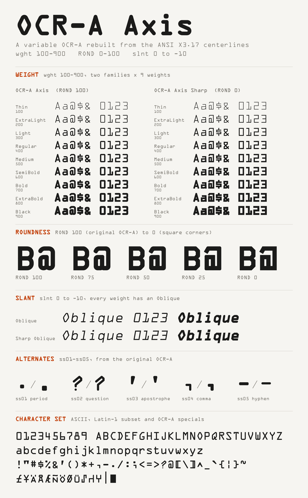

# OCR-A Axis

OCR-Aを、ANSI X3.17-1977の寸法に沿った中心線から組み立て直したバリアブルフォントです。線の太さ、角の丸み、傾きを変えられます。

*A variable OCR-A rebuilt from the ANSI X3.17-1977 centerlines, with weight, roundness and slant axes. See [LICENSE](LICENSE) for the terms (free to use; no fee may be charged for distribution).*



## 軸

| 軸 | 範囲 | 既定 | 内容 |
| --- | --- | --- | --- |
| `wght` | 100〜900 | 400 | 線の太さ。400がANSIの線幅（1000/emで101） |
| `ROND` | 0〜100 | 100 | 角の丸み。100が元の丸いOCR-A、0が角だけの形 |
| `slnt` | −10〜0 | 0 | 傾き（度）。負の値で右に傾く |

送り幅はどの字も723の等幅です。行の高さは1000（emと同じ）です。

## ダウンロード

[Releases](https://github.com/jz5/ocra-axis/releases)から`OCRAAxis-<版>.zip`をダウンロードしてください。中身は次のとおりです。

- `OCRAAxis-VF.ttf`：バリアブルフォント
- `static/`：静的フォント36個
  - **OCR-A Axis**（ROND 100）と**OCR-A Axis Sharp**（ROND 0）の2ファミリー
  - それぞれThin〜Blackの9ウェイト × 立体／Oblique
- `LICENSE`、`README.md`、`preview.png`

バリアブルフォントと静的フォントは、どちらか一方だけをインストールしてください。名前付きスタイルのPostScript名が同じなので、両方を入れるとアプリが取り違えることがあります。

## 代替字形

元のOCR-Aの代替字形を、OpenTypeの機能で切り替えられます（`aalt`でも選べます）。

| 機能 | 字 | 内容 |
| --- | --- | --- |
| `ss01` | `.` | ピリオド |
| `ss02` | `?` | 疑問符（下の点がない形） |
| `ss03` | `'` | アポストロフィ（古い版の形） |
| `ss04` | `,` | カンマ |
| `ss05` | `-` | ハイフン（古い版の形） |

## ウェブでの使い方

```css
@font-face {
  font-family: "OCR-A Axis";
  src: url("OCRAAxis-VF.ttf") format("truetype");
  font-weight: 100 900;
}
.code {
  font-family: "OCR-A Axis", monospace;
  font-variation-settings: "ROND" 50, "slnt" -10;
  font-weight: 700;
}
```

## ビルド

Python 3.9と3.13で確認しています。

```sh
python3 -m venv .venv
.venv/bin/pip install -r requirements.txt
./build.sh
```

`build.sh`は次のものを書き出します。フォントの作成日時は最後のコミットの日時に固定するので、同じソースと同じ環境からは同じバイナリができます（Pythonの版が違うと、計算の誤差で座標が1ユニットずれることがあります）。

- `dist/OCRAAxis-VF.ttf`：バリアブルフォント（`build_ocra.py`）
- `dist/static/`：静的フォント36個（`make_release.py`）
- `preview.png`：見本画像（`make_preview.py`）
- `dist/OCRAAxis-<版>.zip`：Releasesに上げるzip

版や名前、著作権表示は`fontinfo.py`にまとめてあります。

確認ページ（先に`./build.sh`を実行しておく）：

```sh
python3 -m http.server 8765
# http://127.0.0.1:8765/specimen.html を開く
```

確認ページでできること：
- ファミリー・太さ・傾きをボタンで選ぶ。スライダーで中間の値も見られる。
- 表示に使うフォントを、バリアブルフォントと`dist/static/`の静的フォントで切り替える。
- 生成される36スタイルを一覧で見る。
- 元のOCR-A（`ref/OCRA.ttf`）と並べたり重ねたりして比べる。
- 代替字形を切り替える。

### 中心線の作り直し

中心線のデータ`skeleton-round.txt`はコミット済みなので、普段は作り直す必要はありません。作り直すときはMetaPost（`mpost`）を用意し、元のソースを使って次のように実行します。

```sh
./make_skeleton.sh source/ocr-0.3.1 <mpost の実行ファイル> <plain.mp のあるディレクトリ>
```

## 仕組み

- 線1本を1つの輪郭にしています。頂点や端ごとの点の数を固定にして、どのマスターでも点の並びを同じにしています。
- 丸みの途中の値では、角の円弧の半径が小さくなります。端も、丸い端から角丸の長方形を経て長方形に変わります。
- 太いウェイトでは、内側の空間が潰れないよう、一部の字の中心線を動かしています（`build_ocra.py`の`HEAVY_ADJUST`）。
- `│`（Long Vertical Mark）は、どの太さでも上下の端の位置が変わりません。1/6インチの行送りで上下がつながる高さです。
- 斜体は、立体の輪郭を高さ390を中心に傾けたものです。

## 由来とクレジット

- ANSI Standard X3.17-1977
- Tor Lillqvist氏によるMETAFONT版
- Richard B. Wales氏によるMETAFONT定義（1988, 1989）
- Matthew Skala氏によるMetaType1への翻訳。[Tsukurimashou ProjectのOCRパッケージ](https://tsukurimashou.org/ocr.php.ja) 0.3.1に収められている

`source/ocr-0.3.1/`には、このパッケージから中心線の書き出しに使うファイルを、手を加えずに収めています。

## 注意

- 表示や印刷のためのフォントです。OCR機器での読み取りは想定していません。既定の形（wght 400、ROND 100、slnt 0）以外は、ANSI X3.17の形から意図的に変えています。
- `~` `_` `` ` `` `|`の4字はANSI X3.17になく、Wales氏が補ったものです。
- wght 900の斜体では、一部の字が字の枠（0〜723）を少しはみ出します。

## ライセンス

[LICENSE](LICENSE)を参照してください。

- **フォントとフォントのデータ**：Richard B. Wales氏の条件に従い、無料で配布します。自由に使えますが、著作権表示とクレジットを残すこと、配布で実費を超える料金を取らないことが条件です。そのため、フォントを有料で販売したり、有料配布を認めるライセンス（OFLやGPLなど）に変えたりはできません。
- **ビルド用のスクリプト**：MIT Licenseです。
